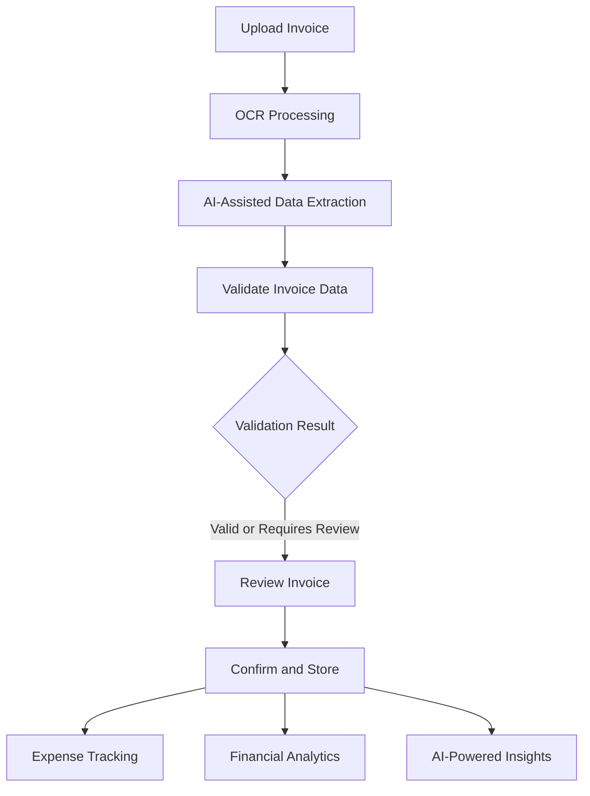
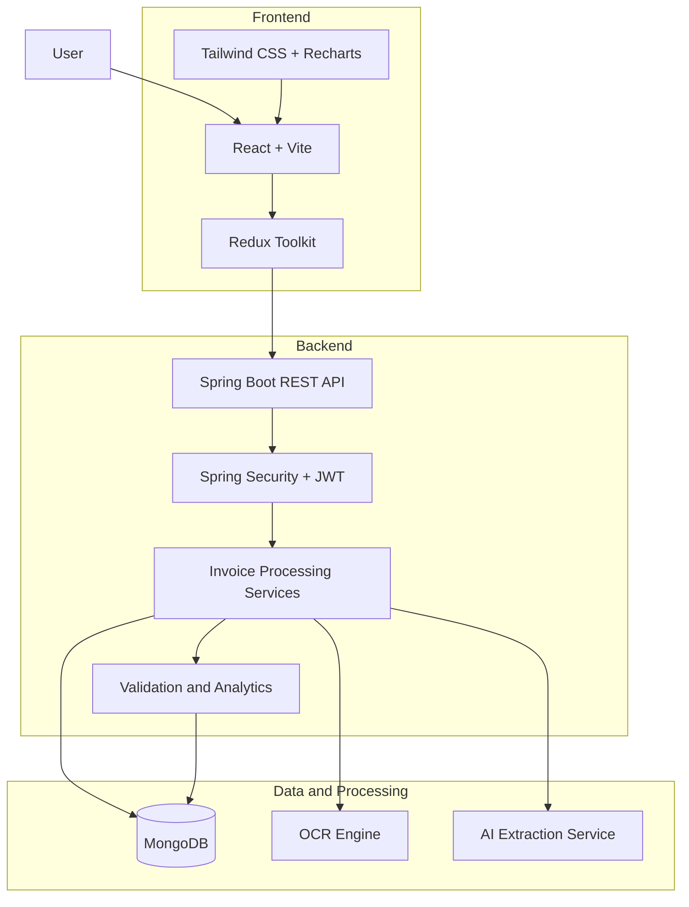

<div align="center">

# 🧾 InvoiceIQ

### Intelligent Finance. Simplified.

**Turn invoices into insights. Automate the busywork. Make smarter business decisions.**

An AI-powered invoice management and financial intelligence platform designed to simplify invoice processing, expense tracking, and business financial analysis.

<br/>


</div>

---

## 📌 Overview

InvoiceIQ is a full-stack application that helps businesses manage invoices more efficiently by combining document processing, OCR, AI-assisted data extraction, validation, expense tracking, and financial insights.

The platform transforms the traditional invoice workflow into a streamlined digital experience.

### 🎯 The Vision

> From invoice chaos to financial clarity — all in one intelligent platform.

---

## ✨ Core Features

### 🔐 Secure Authentication

* User registration and login.
* JWT-based authentication.
* Protected application routes.
* User-specific data access.
* Business profile management.

### 📄 Smart Invoice Management

* Upload invoices in supported PDF and image formats.
* Extract invoice information using OCR and AI-assisted processing.
* Organize invoice data in a centralized workspace.
* Review and update extracted information.
* Track invoice processing status.

### 🧠 Intelligent Invoice Processing

* OCR-based document text extraction.
* AI-assisted structured data extraction.
* Invoice field validation.
* Missing information detection.
* Total amount consistency checks.
* Potential duplicate invoice detection.

### 💰 Expense Tracking

* Invoice-backed expense management.
* Search and filter expenses.
* Filter expenses by category and date.
* View expense summaries.
* Navigate from expenses to their associated invoices.

### 📊 Financial Analytics

* Financial summary cards.
* Spending visualizations.
* Category-based analysis.
* Vendor-based analysis.
* Date-filtered financial reports.

### 💡 AI-Powered Insights

* Financial spending summaries.
* Spending pattern analysis.
* Top vendor and category insights.
* AI-generated recommendations.
* Actionable financial intelligence.

### 👤 Profile Management

* View account information.
* Manage business profile details.
* Access a personalized workspace.

---

## 🔄 How InvoiceIQ Works



The goal is to reduce manual data entry while keeping users involved in reviewing and confirming extracted invoice information.

---

## 🏗️ System Architecture



---

## 🛠️ Technology Stack

### Frontend

| Technology    | Purpose                                |
| ------------- | -------------------------------------- |
| React         | Component-based user interface         |
| Vite          | Frontend development and build tooling |
| JavaScript    | Application logic                      |
| Redux Toolkit | Global state management                |
| React Router  | Client-side routing                    |
| Axios         | HTTP communication                     |
| Tailwind CSS  | Responsive UI styling                  |
| Recharts      | Financial data visualization           |

### Backend

| Technology          | Purpose                            |
| ------------------- | ---------------------------------- |
| Java 25             | Backend programming language       |
| Spring Boot         | REST API and application framework |
| Spring Security     | Application security               |
| JWT                 | Token-based authentication         |
| Spring Data MongoDB | Database integration               |
| Maven               | Dependency management and builds   |

### OCR and AI

| Technology            | Purpose                                     |
| --------------------- | ------------------------------------------- |
| Tesseract OCR         | Text extraction from supported documents    |
| PDFBox                | PDF document processing                     |
| AI extraction service | Structured invoice data extraction          |
| Validation services   | Invoice consistency and data-quality checks |

### Database

* MongoDB for storing application and invoice data.

---

## 📸 Application Preview

Add screenshots of your actual running application to showcase the product.

| Dashboard                                | Invoice Management                     |
| ---------------------------------------- | -------------------------------------- |
| `<!-- Add dashboard screenshot here -->` | `<!-- Add invoice screenshot here -->` |

| Expense Tracking                        | AI Insights                             |
| --------------------------------------- | --------------------------------------- |
| `<!-- Add expenses screenshot here -->` | `<!-- Add insights screenshot here -->` |

**Suggested screenshots:**

* Dashboard overview.
* Invoice list and invoice details.
* Invoice upload and processing.
* Expense tracking page.
* Analytics charts.
* AI insights page.
* Login and registration screens.

---

## 🚀 Getting Started

Follow these steps to run InvoiceIQ locally.

### Prerequisites

Install the following:

* Java Development Kit (JDK).
* Node.js and npm.
* MongoDB.
* Git.
* Maven, or use the Maven Wrapper included in the backend repository.

OCR and AI features may require additional configuration, depending on the selected processing mode.

### 1. Clone the Repository

```bash
git clone https://github.com/SakshiB30/InvoiceIQ.git
cd InvoiceIQ
```

### 2. Configure the Backend

Navigate to the backend directory:

```bash
cd InvoiceIQ_Backend
```

Configure your local application properties and environment variables.

Example environment variables:

```env
JWT_SECRET=your_secure_jwt_secret
GEMINI_API_KEY=your_ai_api_key
GEMINI_ENABLED=false
```

Use a strong, private JWT secret that meets your application's signing requirements.

Configure MongoDB using your local environment settings. Never commit real credentials or API keys.

### 3. Start the Backend

Using the Maven Wrapper on Windows:

```powershell
.\mvnw.cmd spring-boot:run
```

Or, if Maven is installed:

```bash
mvn spring-boot:run
```

The backend is configured to run on:

```text
http://localhost:8080
```

Confirm the actual port and configuration in your local application properties.

### 4. Configure the Frontend

Open a new terminal and navigate to the frontend directory:

```bash
cd InvoiceIQ_Frontend
```

Install dependencies:

```bash
npm install
```

Configure the frontend API base URL according to your environment.

### 5. Start the Frontend

```bash
npm run dev
```

Open the local URL displayed in your terminal, usually:

```text
http://localhost:5173
```

---

## 🔒 Security Considerations

InvoiceIQ incorporates security-oriented application design, including:

* JWT-based authentication.
* Protected routes.
* Server-side user authorization.
* User-specific invoice access checks.
* Password hashing through BCrypt.
* File upload validation and size restrictions.
* Safe file-storage path handling.
* Validation of extracted invoice data.

Security behavior should be verified in the deployed environment before using the platform with sensitive business information.

**Important:** Never commit JWT secrets, database credentials, API keys, access tokens, or production environment files to GitHub.

---

## 🗺️ Project Roadmap

* [x] User registration and login.
* [x] JWT-based authentication.
* [x] Invoice upload and management.
* [x] OCR integration.
* [x] AI-assisted invoice extraction.
* [x] Invoice validation.
* [x] Potential duplicate detection.
* [x] Invoice-backed expense tracking.
* [x] Financial analytics.
* [x] AI-powered insights.
* [ ] Expand automated test coverage.
* [ ] Improve CI/CD workflows.
* [ ] Advanced financial reporting.
* [ ] Automated invoice reminders.
* [ ] Additional business intelligence features.

*The roadmap reflects project goals; update it as features evolve.*

---

## 💡 Why InvoiceIQ?

Traditional invoice processing can involve repetitive data entry, manual validation, scattered records, and limited visibility into spending.

InvoiceIQ brings invoice management, document extraction, validation, expense tracking, and financial analysis into a single workflow.

The project explores how modern web technologies and AI-assisted document processing can make everyday financial operations more efficient.

---

## 🎓 Project Highlights

InvoiceIQ demonstrates practical experience with:

* Full-stack application development.
* REST API design and integration.
* Authentication and authorization.
* Redux-based state management.
* Document processing and OCR.
* AI-assisted information extraction.
* Data validation and duplicate detection.
* Database integration.
* Financial analytics and visualization.
* Responsive user interface design.

---

## 🤝 Contributing

Contributions, suggestions, and feedback are welcome.

1. Fork the repository.
2. Create a feature branch.
3. Implement your changes.
4. Test the changes.
5. Submit a pull request describing the improvement.

Please avoid committing secrets, personal data, or real business invoices.

---

## 📄 License

This project is distributed under the license specified in the repository.

If you intend to use the MIT License, add an appropriate `LICENSE` file before displaying an MIT license badge.

---

<div align="center">

### 🧾 InvoiceIQ

**Intelligent Finance. Simplified.**

*Transform invoices into insights.*

Built with ❤️ using React, Spring Boot, MongoDB, OCR, and AI-assisted processing.

</div>
