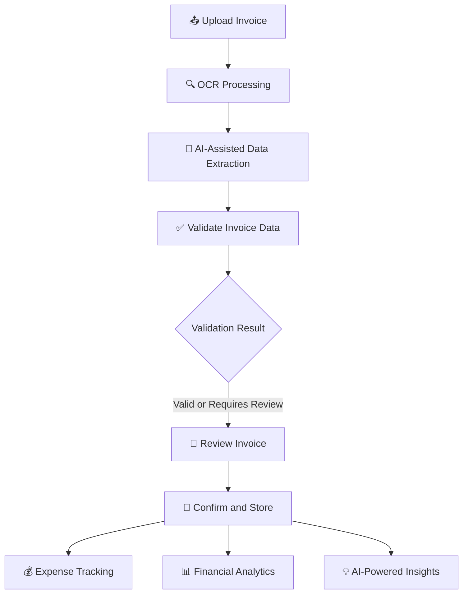

<div align="center">

# 🧾 InvoiceIQ

### *Drop the paperwork. Keep the clarity.*

**Your invoices have stories to tell. InvoiceIQ reads them, checks them, and turns them into decisions.**

An AI-powered invoice and expense intelligence platform that reads your documents, double-checks the numbers, and shows you where your money actually goes.

<br/>


</div>

---

## 🌪️ The Problem

Picture the end of the month: a folder of crumpled PDFs, blurry photos of receipts, a spreadsheet nobody trusts, and one invoice that might have been paid twice.

## 🌤️ The Fix

| Before InvoiceIQ 😵 | With InvoiceIQ 😌 |
| --- | --- |
| Typing invoice fields by hand | Upload once, and OCR + AI do the reading |
| "Did we already pay this?" | Duplicate detection raises a flag |
| Totals that don't add up | Automatic consistency checks |
| Spending hidden in folders | Charts by vendor, category and date |
| Gut-feel budgeting | AI-written insights and recommendations |

> **From invoice chaos to financial clarity, in one intelligent workspace.**

---

## 🎬 The Journey of an Invoice



The machine does the heavy lifting. **You stay in charge**, reviewing and confirming everything before it's stored.

---

## ✨ What You Can Do

### 🔐 Get In Safely
* Register and log in with **JWT-based authentication**.
* Protected routes keep the app private.
* Every user sees **only their own data**.
* Manage your business profile in one place.

### 📄 Wrangle Your Invoices
* Upload **PDFs and images**.
* Let OCR and AI pull out the details.
* Browse everything in one centralized workspace.
* Edit anything the AI got wrong.
* Follow each invoice's **processing status** from upload to done.

### 🧠 A Built-In Second Pair of Eyes
* **OCR** text extraction from documents.
* **AI-assisted** structured data extraction.
* Field validation and **missing-information detection**.
* **Total amount consistency** checks.
* **Potential duplicate** detection.

### 💰 Know Where Every Rupee Goes
* Expenses backed directly by invoices.
* Search and filter by **category** and **date**.
* Quick expense summaries.
* Jump from any expense straight to its source invoice.

### 📊 See the Big Picture
* Financial summary cards.
* Spending visualizations.
* Breakdown by **category** and by **vendor**.
* Reports filtered by date range.

### 💡 Let the Data Talk
* Plain-language spending summaries.
* Spending pattern analysis.
* Top vendors and top categories.
* **AI-generated recommendations** you can act on.

### 👤 Make It Yours
* View account information.
* Manage business profile details.
* Enjoy a personalized workspace.

---

## 🏗️ Under the Hood


---

## 🧰 The Toolbox

### 🎨 Frontend

| Tool | Role |
| --- | --- |
| React | Component-based UI |
| Vite | Lightning-fast dev and build tooling |
| JavaScript | Application logic |
| Redux Toolkit | Global state management |
| React Router | Client-side routing |
| Axios | Talking to the API |
| Tailwind CSS | Responsive styling |
| Recharts | Charts and data visualization |

### ⚙️ Backend

| Tool | Role |
| --- | --- |
| Java 25 | Core language |
| Spring Boot | REST API framework |
| Spring Security | Application security |
| JWT | Token-based authentication |
| Spring Data MongoDB | Database integration |
| Maven | Dependency management and builds |

### 🤖 OCR and AI

| Tool | Role |
| --- | --- |
| Tesseract OCR | Reads text from documents and images |
| PDFBox | PDF processing |
| AI extraction service | Turns raw text into structured invoice data |
| Validation services | Consistency and data-quality checks |

### 🗄️ Database
* **MongoDB** for application and invoice data.

---

## 📸 Sneak Peek

> *Replace the placeholders below with screenshots of your running app.*

| Dashboard | Invoice Management |
| --- | --- |
| `<!-- Add dashboard screenshot here -->` | `<!-- Add invoice screenshot here -->` |

| Expense Tracking | AI Insights |
| --- | --- |
| `<!-- Add expenses screenshot here -->` | `<!-- Add insights screenshot here -->` |

**Screenshot ideas:** dashboard overview · invoice list and details · upload and processing · expense tracking · analytics charts · AI insights · login and registration.

---

## 🚀 Launch It Locally

### 🎒 Pack Your Bags

* JDK
* Node.js and npm
* MongoDB
* Git
* Maven (or just use the bundled Maven Wrapper)

> OCR and AI features may need extra configuration, depending on your processing mode.

### 1️⃣ Clone the Repo

```bash
git clone https://github.com/SakshiB30/InvoiceIQ.git
cd InvoiceIQ
```

### 2️⃣ Set Up the Backend

```bash
cd InvoiceIQ_Backend
```

Configure your local application properties and environment variables:

```env
JWT_SECRET=your_secure_jwt_secret
GEMINI_API_KEY=your_ai_api_key
GEMINI_ENABLED=false
```

Use a strong, private JWT secret, and point the app at your local MongoDB. 🤫 **Never commit real credentials or API keys.**

### 3️⃣ Fire Up the Server

Windows (Maven Wrapper):

```powershell
.\mvnw.cmd spring-boot:run
```

Or with Maven installed:

```bash
mvn spring-boot:run
```

The backend is configured to run at:

```text
http://localhost:8080
```

Double-check the port in your local application properties.

### 4️⃣ Set Up the Frontend

In a new terminal:

```bash
cd InvoiceIQ_Frontend
npm install
```

Set the frontend API base URL to match your environment.

### 5️⃣ Go Live

```bash
npm run dev
```

Open the URL shown in your terminal, usually:

```text
http://localhost:5173
```

🎉 You're in!

---

## 🛡️ Security Mindset

InvoiceIQ is built with security in mind:

* 🔑 JWT-based authentication
* 🚧 Protected routes
* 🧑‍⚖️ Server-side authorization
* 🔒 User-specific invoice access checks
* 🧂 BCrypt password hashing
* 📎 File upload validation and size limits
* 📁 Safe file-storage path handling
* ✅ Validation of extracted invoice data

Verify security behavior in your deployed environment before handling sensitive business data.

> ⚠️ **Never commit** JWT secrets, database credentials, API keys, access tokens, or production environment files.

---

## 🗺️ Roadmap

**Shipped ✅**
- [x] User registration and login
- [x] JWT-based authentication
- [x] Invoice upload and management
- [x] OCR integration
- [x] AI-assisted invoice extraction
- [x] Invoice validation
- [x] Potential duplicate detection
- [x] Invoice-backed expense tracking
- [x] Financial analytics
- [x] AI-powered insights

**Coming next 🔭**
- [ ] Expand automated test coverage
- [ ] Improve CI/CD workflows
- [ ] Advanced financial reporting
- [ ] Automated invoice reminders
- [ ] Additional business intelligence features

*Goals evolve, and so will this list.*

---

## 💭 Why I Built This

Invoices pile up. Data entry is dull. Mistakes sneak in. Spending stays invisible until it's too late.

InvoiceIQ brings **extraction, validation, expense tracking and analysis** into one smooth workflow, and explores how modern web tech and AI can make everyday finance a little less painful.

---

## 🏆 What This Project Showcases

* Full-stack application development
* REST API design and integration
* Authentication and authorization
* Redux-based state management
* Document processing and OCR
* AI-assisted information extraction
* Data validation and duplicate detection
* Database integration
* Financial analytics and visualization
* Responsive UI design

---

## 🤝 Contribute

Ideas, bug reports and pull requests are all welcome.

1. 🍴 Fork the repository
2. 🌿 Create a feature branch
3. 🛠️ Make your changes
4. 🧪 Test them
5. 📬 Open a pull request describing the improvement

Please don't commit secrets, personal data, or real business invoices.

---

## 📄 License

Distributed under the license specified in the repository.

> Using MIT? Add a `LICENSE` file to the repo so the badge above tells the truth.

---

<div align="center">

### 🧾 InvoiceIQ

**Drop the paperwork. Keep the clarity.**

*Every invoice has a story. Now you can read it.*

Built with ❤️ using React, Spring Boot, MongoDB, OCR and AI-assisted processing.

</div>
